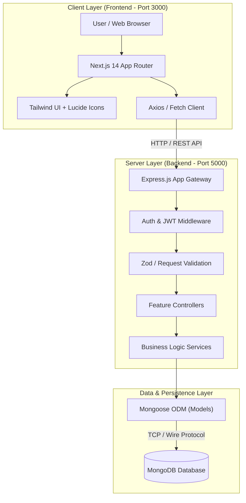
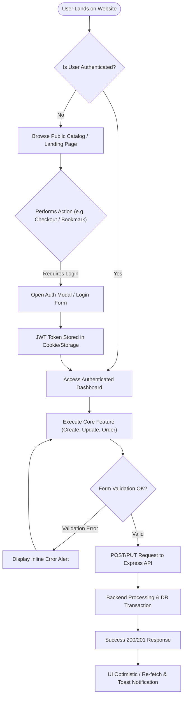
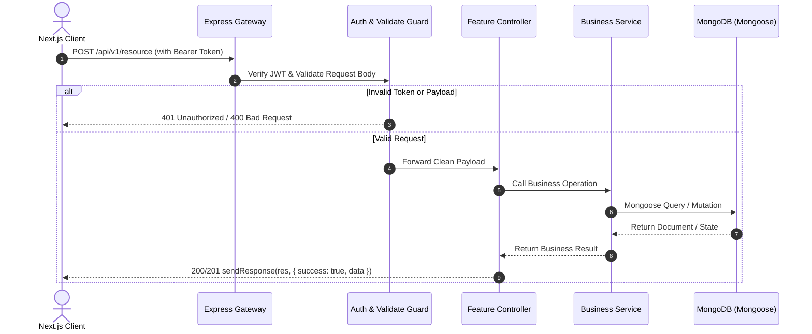
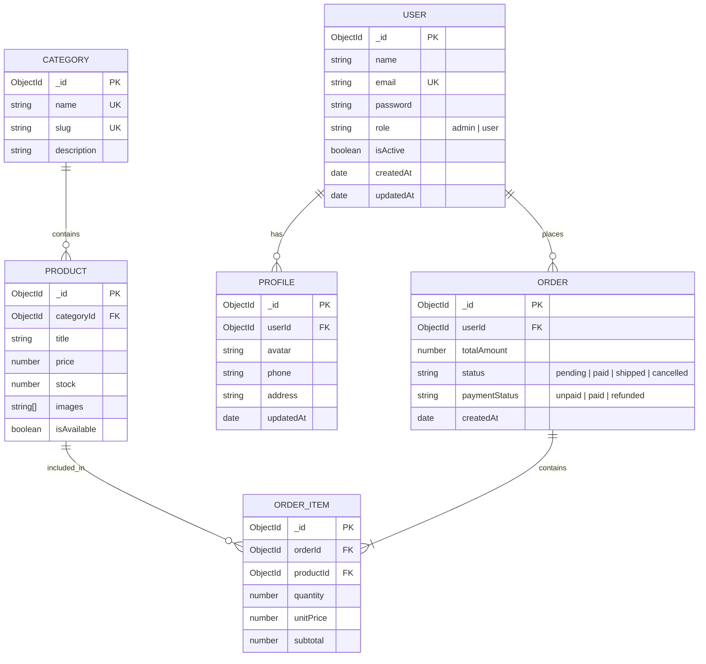

# Product Requirements Document & Architecture Plan

> **Generated on:** [Date]  
> **Source Inputs:** `inputs/client_docs/`, `inputs/screenshots/`, `inputs/references.md`  
> **Status:** Architecture Approved / Ready for Execution

---

## 1. Executive Summary
Brief summary of the client's business, user goals, and primary problem solved.

---

## 2. Execution Strategy Selected
- **Mode:** `FRONTEND_FIRST` | `BOTH_FULLSTACK` | `BACKEND_FIRST`
- **Rationale:** [e.g. "Frontend-First selected to provide client immediate interactive preview at http://localhost:3000 for screenshot confirmation before database wiring."]

---

## 3. Requirements & Overrides
- **Initial Brief (PDF/Doc):** Summary of original requirements.
- **Telegram Chat Overrides:** Specific changes, color preference changes, or feature updates requested during the chat (Telegram strictly overrides earlier briefs).

---

## 4. Visual System & Architecture Flow Diagrams

### 4.1 High-Level System Architecture Diagram


### 4.2 End-to-End User Journey & Process Flowchart


### 4.3 API Request-Response Lifecycle Flow


---

## 5. Database Plan & Schemas (Backend Mongoose)

### 5.1 Visual Entity Relationship Diagram (ERD / ERP Diagram)


### 5.2 MongoDB Architectural Strategy
- **Embedding vs Referencing**:
  - Small, tightly bounded 1-to-few subdocuments (e.g. shipping address, order items snapshot) are embedded directly in the parent document.
  - Large or unbound 1-to-many collections (e.g. Users, Orders, Products, Categories) use referenced ObjectIds (`ref: 'ModelName'`).
- **Indexing Strategy**:
  - Unique index on `email`, `slug`.
  - Compound indexes on query hotpaths (e.g. `{ userId: 1, createdAt: -1 }`, `{ categoryId: 1, isAvailable: 1 }`).
- **Audit & Soft Deletes**:
  - `timestamps: true` (automatically creates `createdAt` and `updatedAt`).
  - `isDeleted: { type: Boolean, default: false }` for safe soft deletion without data loss.

### 5.3 Detailed Mongoose Schemas & Interface Specifications

#### Collection 1: `users`
- **TypeScript Interface:**
```typescript
export interface IUser {
  _id?: string;
  name: string;
  email: string;
  password?: string;
  role: 'admin' | 'user';
  isActive: boolean;
  isDeleted: boolean;
  createdAt?: Date;
  updatedAt?: Date;
}
```
- **Field Specification Table:**
| Field Name | Type | Required | Unique | Default | Index | Description / Validation |
|---|---|---|---|---|---|---|
| `name` | `String` | Yes | No | - | No | Full user name (min 2, max 100) |
| `email` | `String` | Yes | Yes | - | Yes | Lowercase, valid email regex |
| `password` | `String` | Yes | No | - | No | Bcrypt hashed string (hidden by default) |
| `role` | `String` | Yes | No | `'user'` | Yes | Enum: `['user', 'admin']` |
| `isActive` | `Boolean` | No | No | `true` | No | Account status flag |
| `isDeleted` | `Boolean` | No | No | `false` | Yes | Soft-delete flag for queries |

---

## 6. API Endpoints Contract (Backend)

| Method | Endpoint | Request Body | Response Payload | Auth Required | Description |
|---|---|---|---|---|---|
| `POST` | `/api/v1/auth/register` | `{ name, email, password }` | `{ user, token }` | No | User registration |
| `POST` | `/api/v1/auth/login` | `{ email, password }` | `{ user, token }` | No | User authentication |
| `GET` | `/api/v1/items` | Query: `?page=1&limit=10` | `[ items... ]` | No | Paginated item listing |
| `GET` | `/api/v1/items/:id` | - | `{ item }` | No | Single item detail |
| `POST` | `/api/v1/items` | `{ title, ... }` | `{ createdItem }` | Bearer Admin | Create new item |
| `PUT` | `/api/v1/items/:id` | `{ ...partial }` | `{ updatedItem }` | Bearer Admin | Update item |
| `DELETE`| `/api/v1/items/:id` | - | `{ success: true }` | Bearer Admin | Soft delete item |

---

## 7. Frontend Pages & Components (Screenshot Mapping)
- **Screenshots Analyzed:**
  - `screenshot-1.png`: Layout, primary colors, component hierarchy.
  - `screenshot-2.png`: Specific card / grid designs.
- **Responsive Breakpoints:**
  - Mobile (`<640px`): Drawer menu, single-column.
  - Tablet (`640px-1024px`): 2-column cards.
  - Desktop (`>1024px`): Full multi-column view.
- **Design Tokens Extracted:**
  - Primary Color: `#...`
  - Secondary Color: `#...`
  - Background Dark/Light: `#...`
  - Radius & Shadows: `rounded-xl`, `shadow-lg`

---

## 8. Verification & Testing Criteria
- TypeScript compilation checks (`npm run build` in backend, 0 errors)
- Next.js build verification (`npm run build` in frontend, 0 errors)
- 6-State UI Verification (Default, Loading Skeleton, Empty, Error, Responsive, Hover/Focus)

