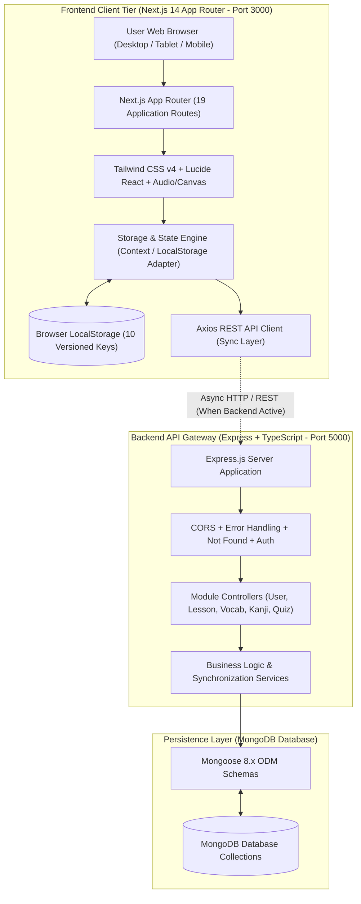
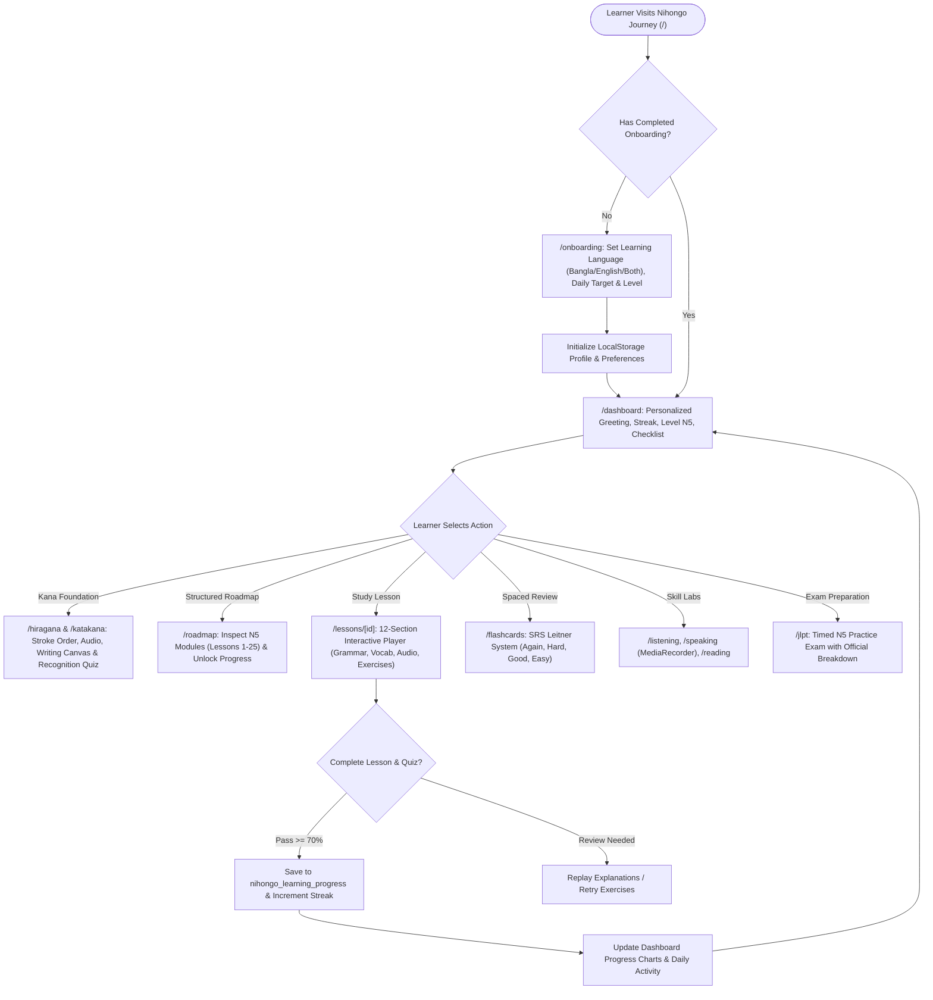
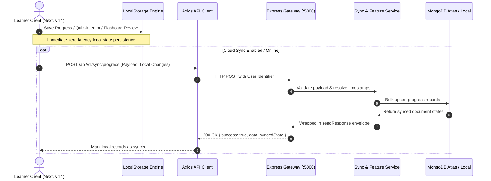
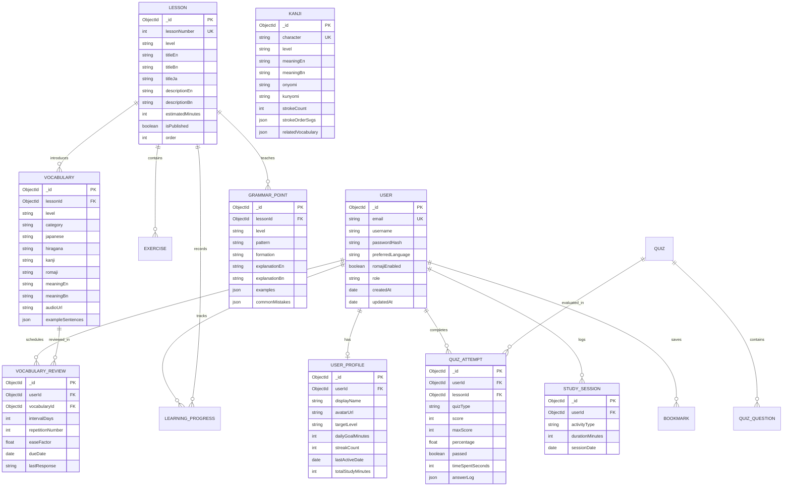

# Product Requirements Document & Architecture Plan: Nihongo Journey (にほんご Journey)

> **Document Version:** 1.0.0  
> **Generated on:** 2026-11-13  
> **Domain:** Personal Japanese Language Learning Web Application (Absolute Beginner to JLPT N5)  
> **Source Inputs:** `inputs/client_docs/requirements.md`, `inputs/client_docs/telegram_chat.txt`, `inputs/screenshots/`, `inputs/references.md`  
> **Execution Strategy:** `FRONTEND_FIRST` (Client Demo Priority -> Native Next.js 14 UI + Local Storage Engine -> Backend Express/MongoDB Sync)  
> **Language Preference:** English (`EN`)

---

## 1. Executive Summary

**Nihongo Journey (にほんご Journey)** is a comprehensive, self-paced Japanese language learning platform designed to guide absolute beginners seamlessly to JLPT N5 mastery, with an expandable foundation for N4 and N3. Tailored specifically for learners, students, and professionals (especially Bangladeshi learners pursuing study and career opportunities in Japan), the platform uniquely supports **trilingual explanations** across **Bangla, English, and Japanese**.

The application combines structured textbook learning (modeled on the *Minna no Nihongo I* curriculum, Lessons 1–25), interactive Kana and Kanji modules, spaced repetition vocabulary flashcards, grammar libraries, audio-rich listening and speaking labs with microphone recording, interactive quizzes, and full simulated JLPT examinations.

In strict accordance with the client requirements and the `FRONTEND_FIRST` strategy, the initial release delivers a 100% interactive, offline-ready frontend operating on browser local storage with zero backend dependencies, while maintaining clean architecture for instant synchronization with the Node.js/Express/MongoDB backend.

---

## 2. Execution Strategy Selected: `FRONTEND_FIRST`

- **Selected Strategy:** `FRONTEND_FIRST`
- **Rationale:** 
  1. The client specification mandates: *"The initial release is frontend-focused and uses local browser storage. It must be usable without authentication or a backend."*
  2. By executing `FRONTEND_FIRST`, the client can immediately preview, test, and validate all 19 interactive screens, audio players, Kana stroke order, flashcards, and quizzes at `http://localhost:3000` with realistic mock data and localStorage persistence before backend APIs are deployed.
  3. All data contracts and interfaces designed for the frontend state directly mirror the Mongoose schemas and REST API contracts, enabling frictionless backend wiring in Phase 2.

---

## 3. Requirements & Overrides Analysis

- **Telegram Chat Inspection (`inputs/client_docs/telegram_chat.txt`):** Inspected. Contains baseline template placeholders without conflicting feature overrides.
- **Client Requirements Brief (`inputs/client_docs/requirements.md`):** 
  - Comprehensive PRD defining 20 core application modules, 19 distinct routes, 10 localStorage persistence keys, specific color themes (Indigo/Purple, Soft Green, Warm Off-White), and bilingual pedagogical models (Bangla + English).
- **Conflict Resolution:** All guidelines from `requirements.md` are adopted with highest fidelity. Architecture is structured as pure MERN (Next.js 14 App Router + Tailwind CSS + Lucide Icons on frontend; Express + TypeScript + Mongoose on backend).

---

## 4. Visual System & Architecture Flow Diagrams

### 4.1 High-Level System Architecture Diagram


### 4.2 End-to-End User Journey & Process Flowchart


### 4.3 API Request-Response Lifecycle Flow


---

## 5. Database Plan & Visual ERD Diagram

### 5.1 Visual Entity Relationship Diagram (ERD)


### 5.2 MongoDB Architecture Strategy
- **Embedding vs. Referencing:**
  - *Embedded:* Lesson exercises, grammar examples, vocabulary example sentences, and quiz questions are embedded inside their respective parent documents to minimize join overhead and optimize single-query lesson loading.
  - *Referenced:* `Vocabulary`, `Kanji`, `VocabularyReview`, `QuizAttempt`, and `LearningProgress` reference the `User` and `Lesson` IDs to support independent querying, filtering, and spaced-repetition scheduling.
- **Indexing Strategy:**
  - `Vocabulary`: Compound index `{ level: 1, category: 1 }` and text index on `{ japanese: "text", hiragana: "text", romaji: "text", meaningEn: "text", meaningBn: "text" }`.
  - `Kanji`: Index on `{ character: 1 }` and `{ level: 1 }`.
  - `VocabularyReview`: Compound index `{ userId: 1, dueDate: 1 }` for instant retrieval of due flashcards.
  - `LearningProgress`: Unique compound index `{ userId: 1, lessonId: 1 }`.
- **Soft-Delete & Audit Timestamps:**
  - All schemas implement `{ timestamps: true }` (`createdAt`, `updatedAt`).
  - Active deletion fields `isDeleted: { type: Boolean, default: false }` for critical user records.

### 5.3 Field-by-Field Specification Tables

#### Table 1: `users` Collection
| Field | Type | Required | Unique | Default | Index | Description |
|---|---|---|---|---|---|---|
| `_id` | ObjectId | Yes | Yes | auto | Primary | Document identifier |
| `email` | String | Yes | Yes | None | Unique | User email address |
| `username` | String | Yes | Yes | None | Index | User display handle |
| `preferredLanguage` | String | Yes | No | `"both"` | No | `"bn"` \| `"en"` \| `"both"` |
| `targetLevel` | String | Yes | No | `"N5"` | No | `"N5"` \| `"N4"` \| `"N3"` |
| `dailyGoalMinutes` | Number | Yes | No | `30` | No | Target daily study commitment |
| `streakCount` | Number | Yes | No | `0` | No | Consecutive days studied |
| `lastActiveDate` | Date | No | No | `Date.now` | Index | Timestamp of last study session |
| `createdAt` | Date | Yes | No | auto | No | Record creation timestamp |
| `updatedAt` | Date | Yes | No | auto | No | Record update timestamp |

#### Table 2: `lessons` Collection
| Field | Type | Required | Unique | Default | Index | Description |
|---|---|---|---|---|---|---|
| `_id` | ObjectId | Yes | Yes | auto | Primary | Lesson identifier |
| `lessonNumber` | Number | Yes | Yes | None | Unique | Lesson order (1 to 25 for N5) |
| `level` | String | Yes | No | `"N5"` | Index | JLPT level classification |
| `titleJa` | String | Yes | No | None | No | Japanese title (e.g., 第1課) |
| `titleEn` | String | Yes | No | None | No | English title (e.g., Introductions) |
| `titleBn` | String | Yes | No | None | No | Bangla title (e.g., আত্মপরিচয়) |
| `sections` | Array | Yes | No | `[]` | No | Embedded array of lesson content blocks |
| `isPublished` | Boolean | Yes | No | `true` | Index | Publication status |

#### Table 3: `vocabularies` Collection
| Field | Type | Required | Unique | Default | Index | Description |
|---|---|---|---|---|---|---|
| `_id` | ObjectId | Yes | Yes | auto | Primary | Word identifier |
| `lessonId` | ObjectId | No | No | null | Index | Associated lesson reference |
| `level` | String | Yes | No | `"N5"` | Index | JLPT level |
| `category` | String | Yes | No | `"General"`| Index | Category (Greetings, Food, Verbs) |
| `japanese` | String | Yes | No | None | Text | Kanji or Kana representation |
| `hiragana` | String | Yes | No | None | Text | Pure Hiragana reading |
| `romaji` | String | Yes | No | None | Text | Latin alphabet transcription |
| `meaningEn` | String | Yes | No | None | Text | English translation |
| `meaningBn` | String | Yes | No | None | Text | Bangla translation |
| `audioUrl` | String | No | No | `""` | No | Audio pronunciation asset path |
| `examples` | Array | No | No | `[]` | No | Embedded example sentences |

---

## 6. Backend Endpoints Specification Matrix

All endpoints adhere to the standard `sendResponse` envelope:
```json
{
  "statusCode": 200,
  "success": true,
  "message": "Operation successful",
  "meta": { "page": 1, "limit": 20, "total": 100 },
  "data": { ... }
}
```

| Method | Endpoint Route | Description / Purpose | Request Payload | Response Data |
|---|---|---|---|---|
| `GET` | `/api/v1/health` | Service health status check | None | `{ status: "UP", timestamp }` |
| `GET` | `/api/v1/lessons` | List lessons filtered by level | Query: `?level=N5` | `Lesson[]` |
| `GET` | `/api/v1/lessons/:id` | Get single lesson with exercises | Param: `id` | `Lesson` (Full details) |
| `GET` | `/api/v1/vocabulary` | List vocabulary with search & filters | Query: `?level=N5&category=food&search=...` | `Vocabulary[]` |
| `GET` | `/api/v1/grammar` | List grammar patterns | Query: `?level=N5` | `GrammarPoint[]` |
| `GET` | `/api/v1/kanji` | List Kanji characters | Query: `?level=N5` | `Kanji[]` |
| `GET` | `/api/v1/reviews/due` | Retrieve flashcards due for SRS review | Query: `?userId=...` | `VocabularyReview[]` |
| `POST` | `/api/v1/reviews/submit` | Record flashcard SRS review response | `{ vocabId, response: "easy"\|"good"\|"hard"\|"again" }` | Updated SRS schedule |
| `POST` | `/api/v1/quiz/submit` | Submit quiz answers and compute score | `{ lessonId, answers: [...] }` | `{ score, passed, explanations }` |
| `POST` | `/api/v1/sync/progress` | Sync local progress to cloud | `{ localState, timestamp }` | Synced progress summary |

---

## 7. Frontend UI & Components Mapping

### 7.1 Visual Tokens & Japanese Aesthetic
- **Color Palette:**
  - Primary Indigo: `#4F46E5` (Brand 600), `#4338CA` (Brand 700)
  - Accent Sakura / Purple: `#7C3AED` (Purple 600), `#EC4899` (Sakura Rose accent)
  - Success / Nature Green: `#10B981` (Emerald 500), `#059669` (Emerald 600)
  - Surface Background: Warm Off-White `#FDFBF7` / Dark Slate `#0F172A`
  - Card Surfaces: Clean White `#FFFFFF` / Dark Card `#1E293B` with border `#F1F5F9`
- **Typography:**
  - English / Latin: `Inter`, sans-serif
  - Japanese Characters: `Noto Sans JP`, `Hiragino Sans`, sans-serif
  - Bangla Text: `Hind Siliguri`, `Noto Sans Bengali`, sans-serif
- **Layout Shell:**
  - **Desktop (`>1024px`):** Left vertical sidebar (collapsible), top app bar with streak flame counter, JLPT N5 pill, and quick language switch.
  - **Tablet (`640px - 1024px`):** Slim sidebar with icon tooltips.
  - **Mobile (`<640px`):** Top compact header + persistent bottom 5-tab navigation bar (Home, Roadmap, Learn, Review, Profile).

### 7.2 Complete 19-Page Route Breakdown & 6-State UI Enforcement
Each screen strictly implements: (1) Default/Success, (2) Loading Skeleton, (3) Empty State, (4) Validation/Error, (5) Responsive Breakpoints, (6) Interactive Hover/Focus States.

| Route | Page Name | Primary Features & UI Modules |
|---|---|---|
| `/` | Landing Page | Hero showcase with Torii-inspired badge, feature highlights, JLPT level roadmap preview, language toggle, and "Start Journey" CTA. |
| `/onboarding` | Learner Setup | Multi-step interactive wizard: Select preferred language (Bangla / English / Both), daily commitment, start level. |
| `/dashboard` | Main Dashboard | Daily study streak counter, JLPT progress ring, Continue Learning hero card, daily checklist, weekly study time bar chart, upcoming revision alert. |
| `/roadmap` | Learning Roadmap | Visual node-based tree of 25 Minna no Nihongo lessons with status indicators (Completed, In Progress, Locked), chapter milestones. |
| `/learn` | Learning Center | Textbook catalog with filter tabs (Lessons 1-5, 6-10, 11-15, 16-20, 21-25), category tags, and duration badges. |
| `/lessons/[id]` | Lesson Player | 12-section master player: Objectives, Japanese conversation with audio, bilingual grammar explanations, interactive exercise engine, end quiz. |
| `/hiragana` | Hiragana Practice | 46 basic characters + Dakuten + Handakuten + Youon charts; stroke order step-player; pronunciation audio; character recognition quiz. |
| `/katakana` | Katakana Practice | Complete Katakana grid; foreign loanword examples; audio playback; stroke order visualizer; randomized test mode. |
| `/vocabulary` | Vocabulary Library | Live search with Romaji/Hiragana/English/Bangla; level and category filters; favorite bookmarking; audio pronunciation buttons. |
| `/flashcards` | Flashcards Lab | 3D card flip animation; Spaced Repetition (Again, Hard, Good, Easy); daily review counter; deck selector. |
| `/grammar` | Grammar Library | Formula pattern cards; Bangla & English explanations; particle usage guides; positive/negative/interrogative examples; trap warnings. |
| `/kanji` | Kanji Lab | Character grid; radical filters; Onyomi/Kunyomi readings; stroke count; interactive stroke order animations; compound vocabulary. |
| `/listening` | Listening Lab | Audio player with speed controls (0.75x, 1.0x, 1.25x); synced transcript with furigana toggle; comprehension multiple-choice questions. |
| `/speaking` | Speaking Lab | Native pronunciation reference; HTML5 MediaRecorder microphone input; waveform playback; shadow repetition; self-evaluation buttons. |
| `/reading` | Reading Lab | Graded reading dialogues; toggleable furigana and English/Bangla translations; inline vocabulary popover definitions. |
| `/quiz` | Quiz Center | Interactive question runners: MCQ, fill-in-the-blanks, matching pairs, sentence unscrambler; instant feedback; review mode. |
| `/jlpt` | JLPT Exam Simulator | Official JLPT N5 format: Language Knowledge, Reading, Listening sections; real countdown timer; question status grid; score sheet. |
| `/progress` | Progress Analytics | Historical study streak calendar; vocabulary mastery chart; lesson completion percentage; accuracy rates; JSON export/import. |
| `/schedule` | Study Planner | Daily routine planner (7:30 - 9:30 PM default template); custom reminder alerts; weekly study day toggles. |
| `/settings` | Settings & Data | Language toggle (Bangla/English/Both); Romaji visibility toggle; audio speed default; LocalStorage backup, export, and reset. |

### 7.3 LocalStorage Persistence Engine
Keys configured with auto-saving, versioning, and validation:
1. `nihongo_user_profile`: User info, selected target level, streak counter, total study time.
2. `nihongo_user_preferences`: Preferred learning language (`"bn"`, `"en"`, `"both"`), Romaji toggle (`true`/`false`), audio speed.
3. `nihongo_learning_progress`: Lesson completion status, exercise scores, unlocked modules.
4. `nihongo_vocabulary_reviews`: Spaced repetition deck states, next review timestamps, ease factors.
5. `nihongo_kanji_progress`: Mastered and in-progress Kanji IDs.
6. `nihongo_quiz_history`: Past quiz attempts, scores, and timestamps.
7. `nihongo_study_sessions`: Daily study logs and time records.
8. `nihongo_daily_activity`: Daily checklist completed items.
9. `nihongo_bookmarks`: Saved vocabulary, grammar points, and lesson bookmarks.
10. `nihongo_schedule`: Configured study routine and reminder settings.

---

## 8. Ordered Execution Task Board (`FRONTEND_FIRST`)

In compliance with `AGENTS.md` and the user's explicit directive, tasks are ordered to build and verify the complete frontend first, followed by backend data models and full-stack integration:

| Task ID | Domain | Title | Dependencies | Deliverables & Scope |
|---|---|---|---|---|
| `TASK-001` | Architecture | Client Intake & Architecture Blueprint | None | Complete PRD, visual flowcharts, ERD, and task board setup. |
| `TASK-002` | Frontend | Design Tokens, Shell Layout, Navigation & Landing Page | `TASK-001` | Tailwind setup, Japanese typography, responsive sidebar & mobile bottom bar, header with streak, and `/` landing page. |
| `TASK-003` | Frontend | Onboarding, Roadmap & Learner Dashboard Views | `TASK-002` | `/onboarding`, `/roadmap`, and `/dashboard` with mock data and localStorage engine. |
| `TASK-004` | Frontend | Kana Mastery Center (Hiragana & Katakana Practice) | `TASK-002` | `/hiragana` and `/katakana` interactive charts, stroke order, audio, and recognition quizzes. |
| `TASK-005` | Frontend | Lesson Engine & Interactive Player (Minna no Nihongo N5) | `TASK-003` | `/learn` curriculum index and `/lessons/[id]` 12-section master lesson player with exercises. |
| `TASK-006` | Frontend | Vocabulary Library, Kanji Lab & SRS Flashcards | `TASK-003` | `/vocabulary`, `/kanji`, and `/flashcards` with Leitner spaced repetition. |
| `TASK-007` | Frontend | Grammar Library, Reading Lab, Listening & Speaking Labs | `TASK-005` | `/grammar`, `/reading`, `/listening` with audio speeds, and `/speaking` with MediaRecorder. |
| `TASK-008` | Frontend | JLPT N5 Exam Simulator, Study Planner & Analytics | `TASK-003` | `/jlpt` timed mock exam, `/schedule` study planner, and `/progress` analytics & export. |
| `TASK-009` | Backend | Backend Data Models & Mongoose Schemas | `TASK-001` | TypeScript interfaces & Mongoose models matching visual ERD. *(Pre-Execution Gate)* |
| `TASK-010` | Backend | Backend REST APIs, Controllers & Validation | `TASK-009` | Express routes, controllers, services, and `sendResponse` envelope handlers. |
| `TASK-011` | Full-Stack | Frontend-Backend Integration & Cloud Sync Engine | `TASK-008`, `TASK-010` | Connect frontend Axios client to backend REST endpoints; implement sync for localStorage. |
| `TASK-012` | QA | Full Platform Verification, E2E Build Audit & Delivery | `TASK-011` | 0 TypeScript compilation errors (`npm run build` on both), cross-browser check, validation suite. |

---

## 9. Developer Stop & Presentation Gate

> [!IMPORTANT]
> **Pre-Execution Gate**: This plan outlines the complete system architecture, visual diagrams, visual ERD, endpoint contracts, frontend mapping, and ordered task board for the `FRONTEND_FIRST` strategy.
> In strict compliance with `AGENTS.md`, no implementation code will be written until the developer reviews and explicitly approves with **"OK"** or **"Proceed"**.
