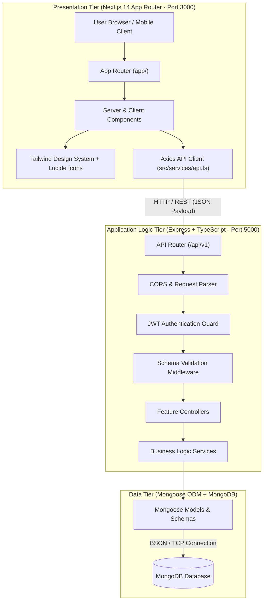
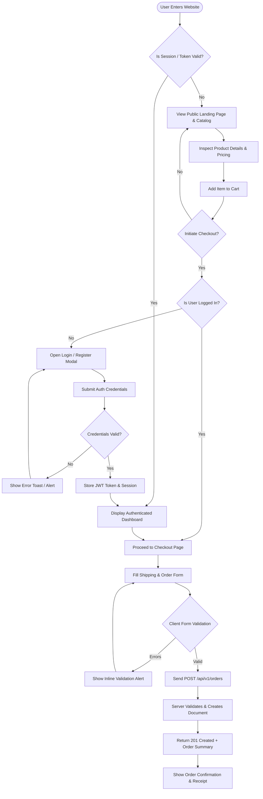
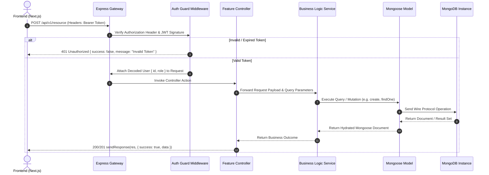
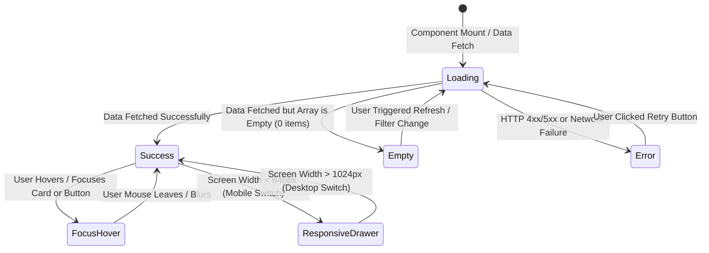
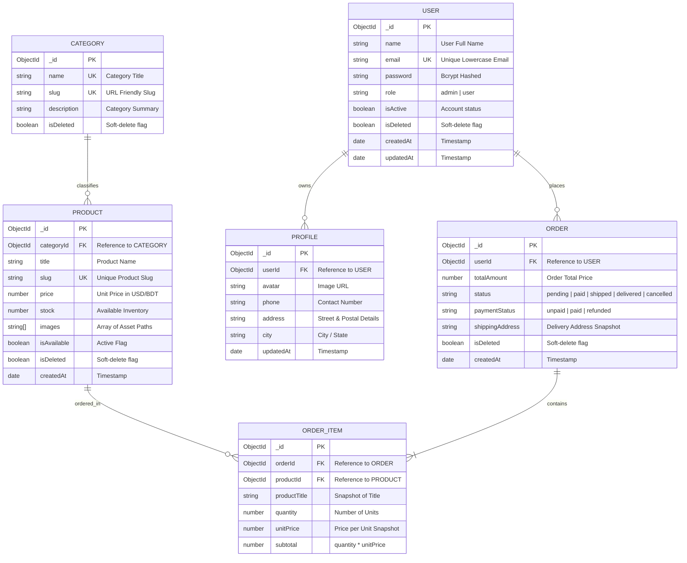

# Software Requirements Specification (SRS)
## EasyTemplate Autonomous MERN Full-Stack Application

> **Document Identifier:** `SRS-ET-2026-V1.0`  
> **Standard Compliance:** IEEE Std 830-1998 & ISO/IEC/IEEE 29148:2018  
> **Status:** Approved / Base Architecture Specification  
> **Target Stack:** Pure MERN (MongoDB, Express, TypeScript, Next.js 14 App Router, Tailwind CSS)  
> **Execution Model:** Zero-Docker, Context-Isolated, Plan-First Autonomous Engine  

---

## Document Control & Revision History

| Version | Date | Author / Role | Status | Description of Changes |
|---|---|---|---|---|
| `1.0.0` | 2026-11-08 | Lead Systems Architect | Approved | Initial baseline SRS synthesized from project config, AGENTS.md protocol, PRD, and MERN core stack specs. |

---

## Table of Contents
1. [Introduction](#1-introduction)
   - [1.1 Purpose](#11-purpose)
   - [1.2 Document Conventions & RFC Standards](#12-document-conventions--rfc-standards)
   - [1.3 Intended Audience & Reading Sequence](#13-intended-audience--reading-sequence)
   - [1.4 Project Scope & Objectives](#14-project-scope--objectives)
   - [1.5 References & Governing Protocols](#15-references--governing-protocols)
2. [Overall System Description](#2-overall-system-description)
   - [2.1 Product Perspective & Context](#21-product-perspective--context)
   - [2.2 System Stack Topology](#22-system-stack-topology)
   - [2.3 Product Functions Summary](#23-product-functions-summary)
   - [2.4 User Classes & Actor Hierarchy](#24-user-classes--actor-hierarchy)
   - [2.5 Operating Environment & Port Allocations](#25-operating-environment--port-allocations)
   - [2.6 Core Design & Execution Constraints](#26-core-design--execution-constraints)
   - [2.7 Assumptions & Hierarchy of Authority](#27-assumptions--hierarchy-of-authority)
3. [System Architecture & Visual Flow Models](#3-system-architecture--visual-flow-models)
   - [3.1 Three-Tier System Architecture Diagram](#31-three-tier-system-architecture-diagram)
   - [3.2 End-to-End User Journey Flowchart](#32-end-to-end-user-journey-flowchart)
   - [3.3 API Request-Response Lifecycle Flow](#33-api-request-response-lifecycle-flow)
   - [3.4 Frontend State Progression Lifecycle](#34-frontend-state-progression-lifecycle)
4. [Data Design & Database Plan](#4-data-design--database-plan)
   - [4.1 Database Engine & Architecture Strategy](#41-database-engine--architecture-strategy)
   - [4.2 Visual Entity Relationship Diagram (ERD / ERP)](#42-visual-entity-relationship-diagram-erd--erp)
   - [4.3 Detailed Schema & Data Dictionary](#43-detailed-schema--data-dictionary)
   - [4.4 Indexing & Query Optimization Strategy](#44-indexing--query-optimization-strategy)
   - [4.5 Soft-Delete & Auditing Policy](#45-soft-delete--auditing-policy)
5. [Detailed Functional Requirements (FR)](#5-detailed-functional-requirements-fr)
   - [5.1 Module 1: System Authentication, Authorization & Security](#51-module-1-system-authentication-authorization--security)
   - [5.2 Module 2: Catalog, Product & Resource Management](#52-module-2-catalog-product--resource-management)
   - [5.3 Module 3: Order Processing, Cart & Transactions](#53-module-3-order-processing-cart--transactions)
   - [5.4 Module 4: Administrative Management & Configuration](#54-module-4-administrative-management--configuration)
   - [5.5 Module 5: Screenshot-to-Exact-Clone Frontend Engine](#55-module-5-screenshot-to-exact-clone-frontend-engine)
6. [External Interface Requirements](#6-external-interface-requirements)
   - [6.1 User Interfaces & Design System](#61-user-interfaces--design-system)
   - [6.2 Hardware & System Interfaces](#62-hardware--system-interfaces)
   - [6.3 Software Interfaces & Internal Routing](#63-software-interfaces--internal-routing)
   - [6.4 Communications Interfaces & Standard Envelope](#64-communications-interfaces--standard-envelope)
7. [Non-Functional Requirements (NFR)](#7-non-functional-requirements-nfr)
   - [7.1 Performance & Latency Criteria](#71-performance--latency-criteria)
   - [7.2 Reliability, Availability & Error Handling](#72-reliability-availability--error-handling)
   - [7.3 Security & Cryptographic Integrity](#73-security--cryptographic-integrity)
   - [7.4 Maintainability, Modularity & Code Quality](#74-maintainability-modularity--code-quality)
   - [7.5 Portability & Zero-Docker Native Execution](#75-portability--zero-docker-native-execution)
8. [Quality Gates, Verification & Acceptance Protocols](#8-quality-gates-verification--acceptance-protocols)
   - [8.1 Continuous Build Verification Gate](#81-continuous-build-verification-gate)
   - [8.2 Mandatory 6-State Frontend Verification Matrix](#82-mandatory-6-state-frontend-verification-matrix)
   - [8.3 Zero-Placeholder Screenshot Fidelity Quality Gate](#83-zero-placeholder-screenshot-fidelity-quality-gate)
   - [8.4 Handover Verification & Platform Delivery Protocol](#84-handover-verification--platform-delivery-protocol)
9. [Requirements Traceability Matrix (RTM)](#9-requirements-traceability-matrix-rtm)

---

## 1. Introduction

### 1.1 Purpose
This Software Requirements Specification (SRS) establishes the foundational, architectural, and functional contract for web applications engineered using the **EasyTemplate** framework. It defines the functional requirements, data models, interaction sequence, UI state governance, and operational quality gates for rapid, high-fidelity client project delivery.

### 1.2 Document Conventions & RFC Standards
This document follows **IEEE 830-1998** standards. Requirement priority and obligation levels follow **RFC 2119** keywords:
- **MUST / SHALL**: Absolute mandatory requirement. Failure to implement blocks build verification.
- **SHOULD**: Highly recommended practice; deviations require justification in `planning/decisions.md`.
- **MAY**: Optional enhancement depending on client brief inputs.

### 1.3 Intended Audience & Reading Sequence
1. **AI Autonomous Agents / Pair Programmers**: Consult Section 3 (Flows), Section 4 (ERD & Schemas), and Section 8 (Quality Gates) prior to writing code.
2. **Full-Stack Developers**: Read Section 2 (Topology), Section 5 (Functional Requirements), and Section 7 (NFRs).
3. **Clients / Reviewers**: Review Section 2.3 (Functions Summary) and Section 3.2 (User Journey Flowchart).

### 1.4 Project Scope & Objectives
The system provides a lightweight, highly responsive, production-ready MERN web application. The core objectives are:
- Deliver client-approved, screenshot-accurate user interfaces in record turnaround time.
- Provide high-throughput, secure REST APIs backed by MongoDB persistence with strict validation envelopes.
- Eliminate containerization and microservice overhead (Zero-Docker constraint) to achieve instant local dev launch and 90% AI token savings.

### 1.5 References & Governing Protocols
- **Core Agent Protocol**: [`AGENTS.md`](file:///c:/Users/Tofayel/Desktop/easytemplate/AGENTS.md)
- **Master Plan & Architecture Blueprint**: [`PRD_AND_PLAN.md`](file:///c:/Users/Tofayel/Desktop/easytemplate/PRD_AND_PLAN.md)
- **Central Project Config**: [`project.config.md`](file:///c:/Users/Tofayel/Desktop/easytemplate/project.config.md)
- **Directory Layout Specification**: [`PROJECT_STRUCTURE.md`](file:///c:/Users/Tofayel/Desktop/easytemplate/PROJECT_STRUCTURE.md)
- **Development & Prompt Shortcuts**: [`PROMPT_SHORTCUT.md`](file:///c:/Users/Tofayel/Desktop/easytemplate/PROMPT_SHORTCUT.md)

---

## 2. Overall System Description

### 2.1 Product Perspective & Context
EasyTemplate operates as a self-contained, context-isolated monorepo with dedicated `frontend/` and `backend/` sub-workspaces orchestrated via a root `package.json`. It connects directly to local or cloud MongoDB instances without requiring Docker, Nginx reverse-proxies, or third-party container engines.

### 2.2 System Stack Topology

```text
┌─────────────────────────────────────────────────────────────────────────┐
│                           CLIENT / BROWSER                              │
│         Next.js 14 App Router + Tailwind CSS + Lucide React             │
│                       (Port: 3000 | localhost)                          │
└────────────────────────────────────┬────────────────────────────────────┘
                                     │ HTTP / REST (Axios / Fetch)
                                     ▼
┌─────────────────────────────────────────────────────────────────────────┐
│                      BACKEND APPLICATION GATEWAY                        │
│                Express 4.x + TypeScript + Node.js 20+                   │
│           Cors | JSON Parser | Auth Guard | Zod Validation              │
│                       (Port: 5000 | localhost)                          │
└────────────────────────────────────┬────────────────────────────────────┘
                                     │ Mongoose 8.x ODM
                                     ▼
┌─────────────────────────────────────────────────────────────────────────┐
│                        DATA PERSISTENCE LAYER                           │
│                 MongoDB Database (Engine: WiredTiger)                   │
│                  Connection URI: mongodb://127.0.0.1:27017              │
└─────────────────────────────────────────────────────────────────────────┘
```

### 2.3 Product Functions Summary
- **Authentication & Role Authorization**: Secure signup, login, session validation via signed JWTs, and role-based access control (Admin / User).
- **Resource Management & Public Catalog**: Full CRUD capabilities for categorized products/items with filtering, sorting, pagination, and search.
- **Ordering & Transaction Lifecycle**: Cart management, checkout, order state progression (Pending $\rightarrow$ Paid $\rightarrow$ Shipped $\rightarrow$ Delivered), and soft-delete safeguards.
- **Screenshot-to-Exact-Clone Visuals**: 100% pixel-perfect UI reproduction with real generated visual assets (zero empty gray placeholder boxes).
- **Automated Continuous Verification**: Pre-commit and pre-handover build validation ensuring zero TypeScript errors.

### 2.4 User Classes & Actor Hierarchy

| Actor Class | Identifier | Authentication Level | Capabilities & Access Permissions |
|---|---|---|---|
| **Anonymous Visitor** | `ACT-GUEST` | Unauthenticated | Browse public catalog, search items, view landing pages, add items to client session cart, initiate login/register. |
| **Authenticated Customer** | `ACT-USER` | JWT Bearer (Role: `user`) | Manage account profile, place orders, review order history, receive notifications, update settings. |
| **System Administrator** | `ACT-ADMIN` | JWT Bearer (Role: `admin`) | Manage product catalog, modify prices/stocks, update order fulfillment status, inspect users, view platform metrics. |
| **Autonomous AI Agent** | `ACT-AGENT` | System Orchestrator | Execute atomic tasks in `planning/tasks/`, verify builds, maintain task states, generate visual assets. |

### 2.5 Operating Environment & Port Allocations
- **Backend Service**:
  - Runtime: Node.js `v20.x+ LTS`
  - Web Server: Express `4.21.x` with TypeScript `5.7.x`
  - Port: `5000` (`http://localhost:5000/api`)
- **Frontend Service**:
  - Framework: Next.js `14.2.x` (App Router) with React `18.3.x`
  - Port: `3000` (`http://localhost:3000`)
- **Database Engine**:
  - MongoDB `v6.x` or `v7.x` (Local daemon or MongoDB Atlas)
  - Connection String: `mongodb://127.0.0.1:27017/easytemplate`

### 2.6 Core Design & Execution Constraints
1. **Zero-Docker Mandate**: All processes MUST execute natively via `npm run dev` or `concurrently`. Docker, Podman, and docker-compose are strictly prohibited.
2. **Context Isolation Mandate**: AI prompt contexts MUST load only the active task file from `planning/tasks/TASK-XXX.md` (~50 lines) to prevent token pollution.
3. **Mandatory 6-State Frontend Rule**: Every interactive page or UI widget MUST implement:
   - (1) Default / Success state
   - (2) Loading Skeleton
   - (3) Empty state
   - (4) Validation / Error alert
   - (5) Responsive breakpoints (`<640px`, `640px-1024px`, `>1024px`)
   - (6) Interactive / Focus state
4. **Standard Envelope Contract**: All Express controllers MUST utilize the `sendResponse` utility envelope for uniform frontend consumption.

### 2.7 Assumptions & Hierarchy of Authority
When inputs conflict, the system adheres to this strict precedence hierarchy:
1. **Active Developer / User Prompt Instructions** (Highest authority).
2. **Telegram Chat Exports** (`messages.html`, `telegram_chat.txt`, `.json` in `inputs/client_docs/`).
3. **Initial Briefs / Requirement PDFs** (`inputs/client_docs/requirements.md`).
4. **Zero-Assumption Rule**: In case of ambiguity not covered in inputs, the requirement MUST be registered in `planning/open-questions.md` without inventing business logic.

---

## 3. System Architecture & Visual Flow Models

### 3.1 Three-Tier System Architecture Diagram



### 3.2 End-to-End User Journey Flowchart



### 3.3 API Request-Response Lifecycle Flow



### 3.4 Frontend State Progression Lifecycle



---

## 4. Data Design & Database Plan

### 4.1 Database Engine & Architecture Strategy
- **Engine**: MongoDB with Mongoose ODM (Object Data Modeling).
- **Strategy (Embedding vs Referencing)**:
  - **Embedded Documents**: 1-to-few, bounded sub-entities that are never queried independently (e.g. `orderItems` within orders, shipping address records) MUST be embedded directly.
  - **Referenced Collections**: 1-to-many or many-to-many entities (e.g. `User $\rightarrow$ Orders`, `Category $\rightarrow$ Products`) MUST use `Schema.Types.ObjectId` references (`ref: 'ModelName'`).

### 4.2 Visual Entity Relationship Diagram (ERD / ERP)



### 4.3 Detailed Schema & Data Dictionary

#### 4.3.1 Collection: `users`
- **Mongoose Interface:** `IUser` in `backend/src/modules/user/user.interface.ts`
- **Specification Matrix:**

| Field Name | Type | Required | Unique | Default | Index | Validation Rules / Notes |
|---|---|---|---|---|---|---|
| `_id` | `ObjectId` | Yes | Yes | Auto | Primary Key | MongoDB generated unique identifier. |
| `name` | `String` | Yes | No | - | No | Min 2, max 100 characters. Trimmed. |
| `email` | `String` | Yes | Yes | - | Yes | Lowercase, trimmed, standard email RFC regex. |
| `password` | `String` | Yes | No | - | No | Bcrypt hashed string. `select: false` by default. |
| `role` | `String` | Yes | No | `'user'` | Yes | Enum: `['user', 'admin']`. |
| `isActive` | `Boolean` | No | No | `true` | No | Operational status of the account. |
| `isDeleted` | `Boolean` | No | No | `false` | Yes | Soft-delete flag. Query hooks filter `{ isDeleted: false }`. |
| `createdAt` | `Date` | Auto | No | Auto | No | Mongoose automatic timestamp. |
| `updatedAt` | `Date` | Auto | No | Auto | No | Mongoose automatic timestamp. |

#### 4.3.2 Collection: `categories`
- **Mongoose Interface:** `ICategory` in `backend/src/modules/category/category.interface.ts`
- **Specification Matrix:**

| Field Name | Type | Required | Unique | Default | Index | Validation Rules / Notes |
|---|---|---|---|---|---|---|
| `_id` | `ObjectId` | Yes | Yes | Auto | Primary Key | Category identifier. |
| `name` | `String` | Yes | Yes | - | Yes | Category display name (e.g. "Electronics"). |
| `slug` | `String` | Yes | Yes | - | Yes | URL slug generated from name. |
| `description`| `String` | No | No | `""` | No | Optional marketing description. |
| `isDeleted` | `Boolean` | No | No | `false` | Yes | Soft delete flag. |

#### 4.3.3 Collection: `products`
- **Mongoose Interface:** `IProduct` in `backend/src/modules/product/product.interface.ts`
- **Specification Matrix:**

| Field Name | Type | Required | Unique | Default | Index | Validation Rules / Notes |
|---|---|---|---|---|---|---|
| `_id` | `ObjectId` | Yes | Yes | Auto | Primary Key | Product identifier. |
| `categoryId` | `ObjectId` | Yes | No | - | Yes | Reference to `categories` collection. |
| `title` | `String` | Yes | No | - | No | Product title. Min 3 chars. |
| `slug` | `String` | Yes | Yes | - | Yes | Lowercase hyphenated URL slug. |
| `price` | `Number` | Yes | No | - | Yes | Decimal number $\ge 0$. |
| `stock` | `Number` | Yes | No | `0` | No | Integer $\ge 0$. |
| `images` | `[String]` | Yes | No | `[]` | No | Local paths in `/images/` or verified URLs. |
| `isAvailable`| `Boolean` | No | No | `true` | Yes | Flag for catalog visibility. |
| `isDeleted` | `Boolean` | No | No | `false` | Yes | Soft-delete flag. |

#### 4.3.4 Collection: `orders`
- **Mongoose Interface:** `IOrder` in `backend/src/modules/order/order.interface.ts`
- **Specification Matrix:**

| Field Name | Type | Required | Unique | Default | Index | Validation Rules / Notes |
|---|---|---|---|---|---|---|
| `_id` | `ObjectId` | Yes | Yes | Auto | Primary Key | Order identifier. |
| `userId` | `ObjectId` | Yes | No | - | Yes | Reference to `users` collection. |
| `totalAmount` | `Number` | Yes | No | - | No | Total sum of all order items. |
| `status` | `String` | Yes | No | `'pending'` | Yes | Enum: `['pending', 'paid', 'shipped', 'delivered', 'cancelled']`. |
| `paymentStatus`| `String`| Yes | No | `'unpaid'` | Yes | Enum: `['unpaid', 'paid', 'refunded']`. |
| `shippingAddress`| `String`| Yes | No | - | No | Snapshot of user's delivery address. |
| `isDeleted` | `Boolean` | No | No | `false` | Yes | Soft-delete flag. |

### 4.4 Indexing & Query Optimization Strategy
1. **Single Field Indexes**: Created on all foreign keys (`userId`, `categoryId`) and status flags (`isDeleted`, `status`).
2. **Compound Indexes**:
   - `products`: `{ categoryId: 1, isAvailable: 1, price: 1 }` for high-speed faceted catalog queries.
   - `orders`: `{ userId: 1, createdAt: -1 }` for instant retrieval of user order histories.
3. **Unique Constraints**: Explicit unique indexes enforce uniqueness on `users.email`, `categories.name`, `categories.slug`, and `products.slug`.

### 4.5 Soft-Delete & Auditing Policy
- Hard deletion (`Model.findByIdAndDelete`) is strictly avoided on transactional models.
- All documents define `isDeleted: { type: Boolean, default: false }`.
- Read queries (`find`, `findOne`) automatically include `{ isDeleted: false }` or utilize Mongoose pre-find middleware.

---

## 5. Detailed Functional Requirements (FR)

### 5.1 Module 1: System Authentication, Authorization & Security

- **`FR-AUTH-001` User Registration**:
  - The system MUST allow visitors to create an account by submitting `name`, `email`, and `password`.
  - Passwords MUST be encrypted using Bcrypt (minimum 10 salt rounds) before persistence.
  - Duplicate email registrations MUST be rejected with HTTP 409 Conflict.

- **`FR-AUTH-002` User Login & Token Issuance**:
  - The system MUST authenticate users with valid email and password credentials.
  - On authentication, the backend MUST issue a signed JWT containing `userId` and `role` with a configurable expiry (e.g. 7 days).
  - Passwords MUST never be returned in response payloads.

- **`FR-AUTH-003` Role-Based Route Guarding**:
  - The system MUST enforce role-based access control (RBAC).
  - Admin-only routes (e.g. Product create/update/delete, Order status update) MUST reject requests from non-admin users with HTTP 403 Forbidden.

- **`FR-AUTH-004` Client Session State**:
  - The frontend MUST maintain session state and attach the JWT as a `Bearer <token>` in the `Authorization` header for all protected API requests.

### 5.2 Module 2: Catalog, Product & Resource Management

- **`FR-CAT-001` Public Catalog Listing**:
  - The system MUST expose a `GET /api/v1/products` endpoint supporting pagination (`page`, `limit`), category filtering (`categoryId`), price sorting (`sort=asc|desc`), and keyword search.

- **`FR-CAT-002` Product Details Retrieval**:
  - The system MUST provide `GET /api/v1/products/:id` returning product metadata, available inventory, category reference, and image gallery.

- **`FR-CAT-003` Administrative Product Management**:
  - Authenticated administrators MUST be capable of creating (`POST`), updating (`PUT`/`PATCH`), and soft-deleting (`DELETE`) product records.

### 5.3 Module 3: Order Processing, Cart & Transactions

- **`FR-ORD-001` Cart Aggregation**:
  - The frontend MUST support adding items to cart, modifying item quantities, and calculating dynamic subtotals and grand totals in local client state.

- **`FR-ORD-002` Order Placement**:
  - Authenticated users MUST be able to submit an order via `POST /api/v1/orders`.
  - The server MUST validate stock availability, compute final prices server-side, create the `Order` and embedded `OrderItems`, and adjust inventory atomically.

- **`FR-ORD-003` Order Tracking & History**:
  - Users MUST be able to query their past orders via `GET /api/v1/orders/my-orders`.
  - Administrators MUST be able to view all orders and update their fulfillment statuses.

### 5.4 Module 4: Administrative Management & Configuration

- **`FR-ADM-001` Platform Health Check**:
  - The system MUST expose `GET /` returning server health status, current timestamp, and API version.

- **`FR-ADM-002` Central Configuration Integrity**:
  - System parameters (database URL, ports, secret keys) MUST be loaded from environment variables (`.env`) with fail-fast validation in `backend/src/config/index.ts`.

### 5.5 Module 5: Screenshot-to-Exact-Clone Frontend Engine

- **`FR-UI-001` Design Token Extraction**:
  - The frontend MUST extract and implement exact color hex codes, font families, card radiuses, and shadow elevations as specified in `inputs/screenshots/` and documented in `project.config.md`.

- **`FR-UI-002` Zero-Placeholder Asset Protocol**:
  - The frontend MUST NEVER utilize generic gray boxes or dummy broken image links.
  - Every hero banner, category thumbnail, product visual, or avatar MUST exist as a high-resolution local file in `frontend/public/images/`.

- **`FR-UI-003` Mandatory 6 UI States**:
  - Every primary feature view MUST implement all 6 states: Default/Success, Loading Skeleton, Empty State, Error Alert with Retry, Responsive Layouts, and Hover/Focus micro-interactions.

---

## 6. External Interface Requirements

### 6.1 User Interfaces & Design System
- **Framework**: Next.js 14 App Router with Tailwind CSS.
- **Iconography**: Lucide React SVG icons.
- **Responsive Layout Breakpoints**:
  - **Mobile (`< 640px`)**: Single column layout, full-width touch targets, slide-out hamburger drawer navigation.
  - **Tablet (`640px - 1024px`)**: Two-column responsive card grids, consolidated header.
  - **Desktop (`> 1024px`)**: Multi-column grids (3 to 4 columns), expanded navigation bar, container max-width `max-w-7xl`.

### 6.2 Hardware & System Interfaces
- Native host machine execution on Windows, macOS, or Linux.
- Minimum hardware requirement: 2 CPU cores, 4 GB RAM, 1 GB free disk space (No virtualization requirements).

### 6.3 Software Interfaces & Internal Routing
- **Backend API Base**: `http://localhost:5000/api`
- **Frontend Local URL**: `http://localhost:3000`
- **Database Driver**: Mongoose connected via TCP to `mongodb://127.0.0.1:27017`

### 6.4 Communications Interfaces & Standard Envelope
All backend endpoints MUST conform to the standard `sendResponse` envelope:

#### 6.4.1 Success Response Payload (`200 OK` / `201 Created`)
```json
{
  "success": true,
  "statusCode": 200,
  "message": "Operation executed successfully",
  "data": {}
}
```

#### 6.4.2 Error Response Payload (`400 Bad Request` / `404 Not Found` / `500 Internal Error`)
```json
{
  "success": false,
  "message": "Descriptive human-readable error explanation",
  "errorSources": [
    {
      "path": "fieldName",
      "message": "Specific validation constraint failure"
    }
  ]
}
```

---

## 7. Non-Functional Requirements (NFR)

### 7.1 Performance & Latency Criteria
- **`NFR-PERF-001`**: API endpoints MUST respond with a 95th percentile latency ($P_{95}$) under $200\text{ms}$ under standard local load.
- **`NFR-PERF-002`**: Next.js Server Components Time to First Byte (TTFB) MUST remain under $500\text{ms}$ on initial load.
- **`NFR-PERF-003`**: Frontend client bundles MUST optimize image assets using WebP/AVIF formats to keep bundle weights lightweight.

### 7.2 Reliability, Availability & Error Handling
- **`NFR-REL-001`**: The backend MUST register a centralized `globalErrorHandler` catching all synchronous and asynchronous exceptions without crashing the Node.js process.
- **`NFR-REL-002`**: Unhandled routes MUST return standard HTTP 404 JSON envelopes via `middlewares/notFound.ts`.
- **`NFR-REL-003`**: MongoDB disconnect events MUST be trapped gracefully with automatic reconnection retries.

### 7.3 Security & Cryptographic Integrity
- **`NFR-SEC-001`**: All sensitive credentials (passwords, API tokens) MUST be hashed or encrypted. Passwords MUST use Bcrypt with salt factor $\ge 10$.
- **`NFR-SEC-002`**: Cross-Origin Resource Sharing (CORS) MUST be configured to whitelist only authorized client origins (e.g. `http://localhost:3000`).
- **`NFR-SEC-003`**: Request bodies MUST be sanitized against NoSQL injection and prototype pollution.

### 7.4 Maintainability, Modularity & Code Quality
- **`NFR-MAINT-001`**: Both frontend and backend MUST adhere to TypeScript strict mode with **0 compilation errors** during `npm run build`.
- **`NFR-MAINT-002`**: Backend codebase MUST follow a modular architecture (`src/modules/<feature>/` comprising `.interface.ts`, `.model.ts`, `.controller.ts`, `.service.ts`, `.route.ts`).
- **`NFR-MAINT-003`**: ESLint and Prettier standards MUST be satisfied across all source files.

### 7.5 Portability & Zero-Docker Native Execution
- **`NFR-PORT-001`**: The entire application MUST build and run natively across Windows PowerShell, Linux Bash, and macOS Zsh without requiring Docker containers or system daemon dependencies.

---

## 8. Quality Gates, Verification & Acceptance Protocols

### 8.1 Continuous Build Verification Gate
Prior to marking any task `DONE` in `planning/task.md` or handing off code to the client:
1. **Backend Verification**: Execute `npm run build` inside `backend/`. Compilation MUST exit with code 0 (zero TypeScript errors).
2. **Frontend Verification**: Execute `npm run build` inside `frontend/`. Next.js page build, type checking, and route compilation MUST complete with zero errors.

### 8.2 Mandatory 6-State Frontend Verification Matrix
For every interactive view developed, verify the existence of all 6 states:

| State | Verification Criterion | Validation Method |
|---|---|---|
| **1. Default / Success** | Visual components render with real data/tokens. | Visual inspection at `http://localhost:3000`. |
| **2. Loading Skeleton** | Smooth pulse skeleton elements match layout during fetch. | Artificial 2-second delay test in API client. |
| **3. Empty State** | Helpful message + Call to Action when dataset is empty. | Test with empty array `[]`. |
| **4. Validation / Error** | Inline alerts highlight invalid inputs or API failures. | Form submit with empty fields / simulated 500. |
| **5. Responsive Breakpoint**| Seamless transitions at `<640px`, `640-1024px`, `>1024px`. | Chrome DevTools device mode viewport toggle. |
| **6. Focus / Hover** | Cards elevate and buttons display active hover tints. | Mouse hover & keyboard Tab navigation. |

### 8.3 Zero-Placeholder Screenshot Fidelity Quality Gate
When client screenshots exist in `inputs/screenshots/`:
- [ ] Navbar logo, links, search input, and action buttons match the screenshot layout.
- [ ] Hero headline hierarchy and background image reflect the screenshot.
- [ ] Card grid columns, borders, border-radius, and badges match screenshot styling.
- [ ] Every image is a real, high-resolution graphic in `frontend/public/images/`.

### 8.4 Handover Verification & Platform Delivery Protocol
When all planned tasks are completed:
- Run `powershell -ExecutionPolicy Bypass -File scripts/validate-project.ps1` (Windows) or `./scripts/validate-project.sh` (Linux/Mac).
- Validate server responses via root health check `http://localhost:5000/`.
- Provide client handover notes with local startup commands (`npm run dev` or `dev.ps1`).

---

## 9. Requirements Traceability Matrix (RTM)

This matrix maps each functional requirement to its responsible development task in `planning/tasks/`:

| Requirement ID | Module Name | Task Mapping | Assigned Domain | Build Verification Gate |
|---|---|---|---|---|
| `FR-AUTH-001` | User Registration | [`TASK-002`](planning/tasks/TASK-002.md), [`TASK-003`](planning/tasks/TASK-003.md) | Backend | `backend/ npm run build` |
| `FR-AUTH-002` | User Login & JWT | [`TASK-002`](planning/tasks/TASK-002.md), [`TASK-003`](planning/tasks/TASK-003.md) | Backend | `backend/ npm run build` |
| `FR-AUTH-003` | RBAC Middleware | [`TASK-003`](planning/tasks/TASK-003.md) | Backend | `backend/ npm run build` |
| `FR-AUTH-004` | Client Auth State | [`TASK-005`](planning/tasks/TASK-005.md) | Frontend | `frontend/ npm run build` |
| `FR-CAT-001` | Public Catalog | [`TASK-003`](planning/tasks/TASK-003.md), [`TASK-005`](planning/tasks/TASK-005.md) | Full-Stack | Both builds exit code 0 |
| `FR-CAT-002` | Product Detail | [`TASK-003`](planning/tasks/TASK-003.md), [`TASK-005`](planning/tasks/TASK-005.md) | Full-Stack | Both builds exit code 0 |
| `FR-CAT-003` | Admin Product CRUD | [`TASK-003`](planning/tasks/TASK-003.md) | Backend | `backend/ npm run build` |
| `FR-ORD-001` | Client Cart | [`TASK-005`](planning/tasks/TASK-005.md) | Frontend | `frontend/ npm run build` |
| `FR-ORD-002` | Order Placement | [`TASK-003`](planning/tasks/TASK-003.md), [`TASK-005`](planning/tasks/TASK-005.md) | Full-Stack | Both builds exit code 0 |
| `FR-ORD-003` | Order History | [`TASK-003`](planning/tasks/TASK-003.md), [`TASK-005`](planning/tasks/TASK-005.md) | Full-Stack | Both builds exit code 0 |
| `FR-ADM-001` | Platform Health | [`TASK-003`](planning/tasks/TASK-003.md) | Backend | `backend/ npm run build` |
| `FR-UI-001` | Design Tokens | [`TASK-004`](planning/tasks/TASK-004.md) | Frontend | `frontend/ npm run build` |
| `FR-UI-002` | Zero-Placeholder | [`TASK-004`](planning/tasks/TASK-004.md), [`TASK-005`](planning/tasks/TASK-005.md) | Frontend | Visual & build check |
| `FR-UI-003` | 6 Mandatory States | [`TASK-004`](planning/tasks/TASK-004.md), [`TASK-005`](planning/tasks/TASK-005.md) | Frontend | 6-State Verification |

---

*End of Software Requirements Specification (SRS).*
