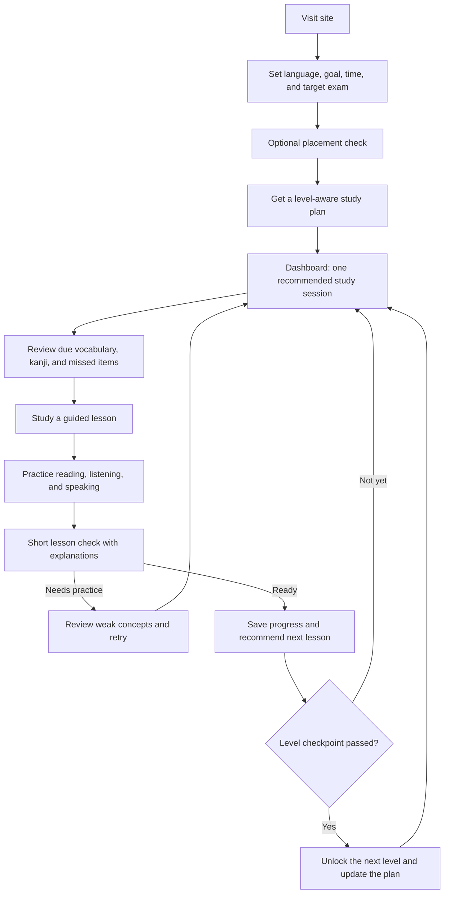

# Nihongo Journey: N5-to-N1 Learning Journey Plan

## Purpose

Expand Nihongo Journey from its current N5-first prototype into a clear, sustainable path from absolute beginner through JLPT N1. The learner experience should feel like one guided journey, not a collection of disconnected practice pages.

## Current-state analysis

- The project brief describes beginner-to-N3 goals; the developer's current goal extends the destination to N1. N4, N2, and N1 are not yet represented as complete curriculum levels.
- The curriculum dataset contains 25 N5 lesson summaries, but detailed lesson content currently exists only for Lessons 1 and 2. Other lesson routes rely on fallback content.
- The 12-section player is a useful starting structure, but it does not yet ensure every scored exercise is presented. A lesson can also be marked complete when it has no quiz challenges, and lesson navigation is not gated by completion.
- Navigation advertises several learning areas whose routes are not implemented yet. This should be treated as planned scope, not finished functionality.
- The current release is local-first and uses browser storage. Keep that working independently of any later account or cloud-sync work.

## Product principles

1. Guide one next action at a time: explain what to study now, why it matters, and what comes next.
2. Teach through a balanced mix of vocabulary, grammar, kanji, reading, listening, and speaking; connect the skills to the same level and lesson.
3. Use Bangla and English explanations with Japanese examples as established in the current brief; keep romaji optional.
4. Make review adaptive and useful: prioritize due items and previously missed concepts without punishing learners for breaks.
5. Do not mark a level or feature as available until its content and assessment path exist.
6. Use original or properly licensed learning material. Aligning with JLPT objectives does not require copying copyrighted textbook pages or proprietary exam questions.
7. Preserve a usable local-first experience; accounts and cloud sync are a later, optional product decision.

## Level-aware content architecture

Keep the learning experience and its reusable tools shared, while keeping authored learning content inside its JLPT level package. Do not copy the lesson player, grammar cards, vocabulary UI, SRS scheduler, or skill-lab pages five times.

```text
frontend/src/
  app/                         # Shared routes and navigation
  components/                  # Shared UI and interaction components
  content/
    shared/
      types.ts                 # Level-neutral lesson, item, and exercise contracts
      registry.ts              # N5-N1 metadata and availability checks
      kana.ts                  # Shared kana foundation
    levels/
      n5/
        index.ts               # Level metadata and content exports
        curriculum.ts
        lessons.ts
        vocabulary.ts
        kanji.ts
        skills.ts                # Grammar, reading, listening, and speaking content
      n4/
        index.ts               # Planned until the N4 content gate passes
      n3/
        index.ts
      n2/
        index.ts
      n1/
        index.ts
```

The shared registry must know about all five levels, but a level is not selectable as available just because its folder exists. Each level package reports its state (`planned`, `in-progress`, or `available`) and the completeness checks it has passed. Shared routes request content by level and lesson ID; level-specific files contain the content, not duplicate page implementations. Use stable IDs and explicit prerequisite links so progress, SRS, and assessment remain associated with the right level.

Move the current N5 curriculum, lesson details, vocabulary, kanji, and new skill-lab material into the N5 package as the foundation is implemented. Keep kana and UI primitives shared. N4, N3, N2, and N1 packages should be populated and reviewed one level at a time; do not seed them with empty or misleading “complete” content.

**Implementation status:** The shared contracts, ordered N5–N1 registry, common kana package, and level folders are in place. N5 exports its curriculum, lesson details, vocabulary, kanji, grammar, reading, listening, and speaking content; N4–N1 currently contain level metadata only and remain planned. This is a structural foundation, not complete N5–N1 coverage: N5 still needs comprehensive lesson and skill content before it can be marked available.

## Recommended learner journey



## Feature plan and priority

### Phase 0 — Product and content foundation

- Define a reusable hierarchy: JLPT level → module → chapter → lesson → learning item → exercise → assessment.
- Give each learning item level, skill, prerequisites, language variants, source/licensing metadata, and completion criteria.
- Separate curriculum metadata from lesson content so N4–N1 can reuse the same player and practice tools.
- Decide which levels are genuinely available versus planned, and show that distinction in the roadmap.

**Exit check:** The data model can represent N5–N1 without level-specific page duplication; unavailable content cannot appear complete.

### Phase 1 — Make the existing N5 journey reliable

- Complete original, reviewed content for all 25 N5 lessons before presenting the N5 course as complete.
- Ensure all counted questions are visible and answerable; persist attempts and explanations; use a clear pass/retry flow.
- Gate lesson completion and subsequent lessons consistently; provide a way to revisit completed lessons.
- Add an onboarding goal and optional placement check, then show a daily learning queue combining lessons and due reviews.
- Connect lessons to vocabulary, grammar, kanji, and skill practice rather than treating those modules as separate islands.
- Add empty, loading, error, success, and keyboard/focus states where content is loaded or actions can fail.

**Exit check:** A learner can start at the foundation, complete the N5 path, recover from mistakes, resume later, and see truthful progress using saved data.

### Phase 2 — Build reusable learning systems

- Vocabulary library: search, level/lesson/category filters, favorites, example sentences, audio, and personal collections.
- Spaced repetition: due queue and Again/Hard/Good/Easy scheduling; reviews should feed dashboard and progress.
- Kanji lab: readings, meanings, stroke count/order, related vocabulary, writing/recognition practice, and level filters.
- Grammar library: patterns, formation, bilingual explanations, examples, common mistakes, and linked exercises.
- Reading/listening/speaking practice: level-appropriate material, comprehension checks, transcripts/translations, playback controls, and user-controlled recording.
- JLPT practice: timed and untimed modes, review flags, explanations, incorrect-answer review, and skill breakdown.
- Study plan and analytics: editable goals, weekly schedule, real saved activity, and transparent readiness indicators.

**Exit check:** Each system uses the same level and progress model, and its activity contributes to the learner's review queue and progress view.

### Phase 3 — Expand level-by-level: N4 → N3 → N2 → N1

For each level, publish a complete, quality-checked curriculum before labeling that level available:

1. Define measurable language outcomes and prerequisite links.
2. Create original lessons and level-appropriate vocabulary, grammar, kanji, and skill practice.
3. Add a diagnostic or checkpoint, review plan, and JLPT-style practice set.
4. Pilot the level flow and correct content and usability gaps before starting the next level.

Keep the experience consistent while increasing reading length, grammar complexity, vocabulary depth, listening speed, and ambiguity gradually. Do not treat the same number or format of lessons as a requirement across levels; design the curriculum around learning outcomes.

**Exit check per level:** The level has a published roadmap, complete learning and assessment coverage, working prerequisites, and accurate progress reporting.

### Phase 4 — Accounts and cross-device continuity (decision pending)

- Only after the local-first journey works end-to-end, add optional account creation and secure progress synchronization if the product needs it.
- Retain guest use, export/import, conflict handling, and explicit sync status; do not make sign-in a prerequisite for learning unless approved.

## Suggested user-facing navigation

- **Home / Dashboard:** today's plan, due reviews, continue learning, and a concise progress summary.
- **Roadmap:** foundation plus N5, N4, N3, N2, and N1; clearly label available, in progress, and planned levels.
- **Learn:** level → module/chapter → lesson.
- **Practice:** vocabulary, kanji, grammar, reading, listening, and speaking, filtered by level.
- **JLPT Prep:** diagnostics, checkpoints, mock exams, and review of missed concepts.
- **Progress / Plan / Settings:** real activity, adjustable study goals, language and accessibility preferences, and data management.

Reuse existing routes where practical instead of adding a separate page for every feature.

## Recommended implementation order

1. Establish the shared N5-N1 content contracts, level registry, and level-specific folder structure.
2. Complete and quality-check the N5 curriculum across lessons, vocabulary, grammar, kanji, reading, listening, speaking, and assessment.
3. Finish the shared learning tools against the N5 package; close lesson-player scoring, progression, and review gaps.
4. Populate, verify, and publish N4, then N3, then N2, then N1 using the same contracts and shared tools.
5. Decide whether optional accounts and cloud sync are needed after the local-first journey works end-to-end.

## Decisions required before scheduling level expansion

- Confirm whether Bangla + English + Japanese remains the language set for the N5–N1 product.
- Confirm that higher levels should be released sequentially after N5 quality gates, rather than presented as available in parallel.
- Identify authorized content sources or approve original JLPT-aligned content; do not reproduce restricted textbook or exam material.
- Decide whether guest/local-first learning remains the default and accounts/sync are deferred.

This is a product plan, not an implementation approval. Keep the existing task board unchanged until the developer confirms the decisions and asks to schedule or execute the next work.
